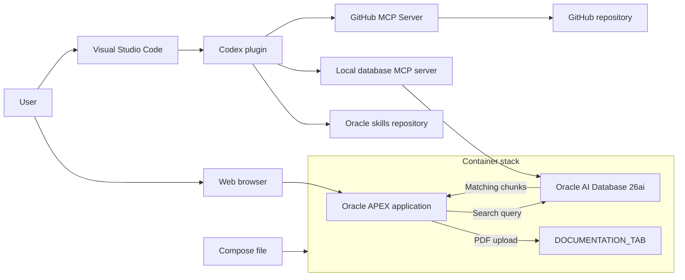

# Heapcon 2026 Demo Repository

This demo repository accompanies the presentation titled "MCP Supercharges APEX: Less Clicking, More Kicking — Straight to Git Push Done"

It is part of [Heapcon 2026](https://heapcon.io/2026/speakers/martin-bach-sonja-meyer) and demonstrates the use of AI coding agents for low-code applications, according to this abstract.

## MCP Supercharges APEX: Less Clicking, More Kicking — Straight to Git Push Done

Modern development teams need more than fast UI creation: they need Git-based workflows, clean CI/CD pipelines, reproducible deployments and reliable engineering practices. Low-code is growing up — from rapid prototyping to real software delivery.

With MCP and AI-powered workflows, low-code becomes not only faster, but also smarter and more resilient. This session focuses on live demos: APEX apps in plain text, versioned in Git, tested automatically, deployed through pipelines and supported by intelligent language-model workflows. Instead of slides, you’ll see how SQLcl, APEXlang, Podman and MCP turn low-code into a real development flow that cuts repetitive work, boosts quality and frees teams to build better solutions.

## Implementation

The code relies on the following Oracle stack:

- [Oracle AI Database 26ai](https://www.oracle.com/database/) 23.26.3 or later
- [Oracle APEX](https://apex.oracle.com) 26.2 and later

A compose file starts the entire stack, initialises the database, and installs APEX.

Once started, an ONNX model is loaded into the database. It is the `sentence-transformers/all-MiniLM-L12-v2` sentence-transformer model, used to create text embeddings. It turns text into a 384-dimensional vector, which can be used to find text with similar meaning—for example, matching a search query to relevant documents even when they do not use the same words. The APEX app uses this model to prepare document chunks and search queries.

The APEX application lets users upload PDFs into the database. They can then split the PDFs into chunks and generate vector embeddings for those chunks. The database stores both the chunks and their embeddings.

A vector search page allows you to use semantic search within these uploaded documents.

## Demo

The demo uses AI agents, MCP servers, and skills. During the presentation, it used:

- Oracle AI Database and APEX, running in containers
- Visual Studio Code (VSCode)
- Codex plugin
- Skills as per the [Oracle _skills_ repository](https://www.github.com/oracle/skills)
- A local MCP server, based on the SQL Developer extension for VS Code, to communicate with the database
- The GitHub MCP Server to interact with the repository using natural language

The diagram shows how the user-facing APEX application and the coding-agent workflow connect to the database and repository:



## Demo steps

Prerequisites: environment has been set up, ONNX model hs been loaded into the database. A saved connection exists in VSCode allowing the SQLcl MCP server to connect to the dev database. A GitHub Personal Access Token (PAT) has been generated with appropriate access rights to the repository. The application has provided in _main_ has been deployed into the local APEX environment.

### Application Walkthrough

Open the APEX runtime, log in, and run the _Heapcon_ application.

1. Prepare documents for vector search

   - Show the vector provider _LOCAL_ONNX_EMBEDDINGS_ in _Workspace Utilities_.
   - In _Knowledge Sources_, upload a couple of PDFs from the Oracle documentation set.
   - Click **Chunk and vectorise** to create chunks and embeddings in the database.
   - In Object Browser, show the chunks and embeddings in `DOC_CHUNKS`.

2. Try semantic search

   - Open _Vector Search_.
   - Enter a search term.
   - Review the semantic search results.

This concludes the first part.

### CI/CD demo

Switch to VS Code for the remainder of the demo.

- Briefly walk through the APEXlang folder structure in `apps/heapcon`.
- Explain the human-readable (APEXlang) format.
- Show the Oracle database skills using this prompt:

```text
Show me all currently available skills
```

- Then use codex settings to do the same.
- Demonstrate the MCP server configuration in Codex.

Introduce a possible workflow for CI/CD with APEXlang:

1. Use the database MCP server to learn more about the application's database part.

    - Connect to the database using these prompts:

    ```text
   List all my database connections
    ```

   With the connections listed, pick the one suitable for this demo and take a note. It's needed in the next step

   ```text
   Connect to the database using <connection name>. Once connected, tell me more about
   the DOCUMENTATION_TAB and DOC_CHUNKS table. What are their purposes?
   ```

   Let's perform a semantic search using natural language

   ```text
   Can you run a semantic search using the vector embeddings stored in doc_chunks? I want to see
   hits matching the search term "MLE". After successful completion, show me the query used. If
   there are multiple embedding models available, make me choose one.
   ```

2. Create a new GitHub issue

   Use the GitHub MCP Server and this prompt to change the look of the _chunk and vectorise_ button.

   ```text
   List my GitHub repositories
   ```

   ```text
   Create a GitHub issue in heapcon-20260-demo requesting that the "Chunk and vectorise" button
   use the "Text with Icon" button type, is not marked hot, and displays the fa-cubes icon. Its
   colour should be purple. Assign the issue to martin-bach-oracle. First explain the actions you
   propose, then wait for approval before creating the issue.
   ```

   Verify that the issue was created in GitHub and assigned correctly.

3. Create a local branch and implement the change via a pull request

Changes in CI/CD should follow the mantra of being small, and incremental.

   - Name the branch after the issue, for example `issue-<number>-<issue title>`.
   - Ask Codex to create and switch to that branch:

      ```text
      Create a local branch named after the newly created issue in the format 
      issue-<number>-<issue title> and switch to it.
      ```

   - Continue _only_ if VSCode indicates that the new branch is active.
   - Ask Codex to make the change to APEX Page 2. It should tell us that it uses the APEX skill to do so. The precise 

      ```text
      On APEX Page 2, update the existing “Chunk and vectorise” button in place (do not add
      another button). Set its button type to Text with Icon, turn Hot off, and use the
      fa-cubes icon on the left. Make the button purple (#7b2cbf) with white text, and use
      a darker purple (#6823a2) for hover, focus, and active states. The button's edges need
      to be round with a font size of 0.9375rem
      ```

   - Review the changes in VSCode; the APEXlang file should allow for an easy, side-by-side comparison.
   - Import the application using the VSCode plugin. Login to the app and show the changed button.
   - If the changes look good, ask Codex to stage and commit them, then publish the branch and create a GitHub pull request:

     ```text
     Stage and commit the changed files. Once committed, publish the branch to GitHub and
     create a pull request. Make sure to link to the previously created issue, stating
     that the fix closes it. First explain the actions you propose, then wait for my 
     approval before proceeding.
     ```

   - Review the pull request. Again, the APEXlang format makes it easy to see which components changed.
   - Manually approve the pull request and watch the CI workflow validate the APEX application.

### Wrap Up

This demo combines low-code development with AI agents, MCP servers, and skills. Together, natural-language instructions and a repeatable development workflow reduce routine work and leave more time for features and usability.
